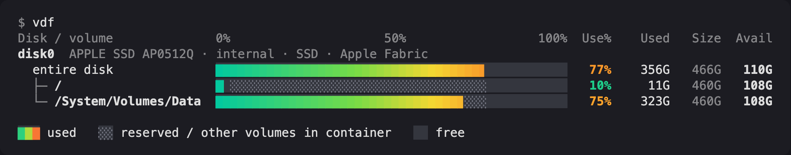

# vdf: visual disk free

[](https://github.com/jggonz/vdf/actions/workflows/ci.yml)
[](https://github.com/jggonz/vdf/releases/latest)
[](LICENSE)

`df -h`, but you can see it at a glance. Every physical disk gets a horizontal
colour-gradient capacity bar, and the volumes mounted from it are listed
underneath.



- **Disk view and volume view.** See how full the physical media is, not just
  each mount point. The bar shows used, free and unallocated space.
- **Gradient bars** drawn to 1/8-character precision. The gradient spans the full
  width of the bar, so fuller drives reach further into the red.
- **APFS-aware on macOS.** Used space is the per-volume figure, the same one
  `df` reports. Volumes that share a container are drawn that way, and they are
  counted once in totals.
- **Linux support** through `/sys/block`, including partitions, LVM/LUKS
  (device-mapper) and md RAID.
- **One small native binary** with no runtime dependencies. It starts in a few
  milliseconds.

## Install

### macOS installer

Download **`vdf-<version>.pkg`** from the
[latest release](https://github.com/jggonz/vdf/releases/latest) and open it.
It installs `/usr/local/bin/vdf` (a universal binary for Apple silicon and Intel)
and the `vdf(1)` man page.

> The package is not yet signed with an Apple Developer ID. When you open it
> from a browser download, macOS says it can't verify the developer. To install
> it anyway, choose **System Settings → Privacy & Security → Open Anyway**, or
> install it from Terminal:
>
> ```sh
> curl -LO https://github.com/jggonz/vdf/releases/latest/download/vdf-1.0.0.pkg
> sudo installer -pkg vdf-1.0.0.pkg -target /
> ```

### Homebrew (macOS and Linux)

```sh
brew install jggonz/tap/vdf
```

### Prebuilt binaries

Every [release](https://github.com/jggonz/vdf/releases) includes tarballs for
`macos-universal`, `linux-x86_64` and `linux-aarch64`. The Linux builds are
static, linked against musl. Extract the tarball and put `vdf` somewhere on your
`PATH`. Each release also has a `SHA256SUMS` file.

### From source

You need Rust 1.85 or later.

```sh
cargo install --git https://github.com/jggonz/vdf
# or
git clone https://github.com/jggonz/vdf && cd vdf && sudo make install
```

## Usage

```
vdf                  # disks, each with the volumes mounted from it
vdf -d               # physical disks only
vdf -f               # flat volume list, like df -h
vdf ~ /Volumes/USB   # only the filesystems that hold these paths
vdf -l               # also show device and filesystem type
vdf -n               # volume names ("Macintosh HD") instead of mount points
vdf -T               # grand-total row
vdf -i               # inode usage
vdf -a               # include pseudo, system and hidden filesystems, like df -a
vdf -f -s pct -r     # fullest volumes first (sort by mount|size|used|avail|pct)
vdf -L               # local filesystems only
vdf -t apfs -x nfs   # include or exclude filesystem types
vdf --theme ocean    # heat (default), ocean, sunset, forest, rainbow, mono
vdf --json           # disks and volumes as JSON
```

Other options: `--color auto|always|never|256|truecolor`, `--ascii`, `-H/--si`
(powers of 1000), `-w WIDTH`, `--bar-max N`, `--max-name N`, `--warn PCT` (adds
`!` at or above this usage; the default is 90), `--no-header` and `--no-legend`.
Set `VDF_THEME` to change the default theme. `NO_COLOR` is honoured. Run
`man vdf` for the full reference.

## Reading the bars

| segment | meaning |
| --- | --- |
| gradient `█` | used |
| grey hatch `░` (`▒` without colour) | space this volume can't use: other APFS volumes in the same container or reserved root blocks. On a disk with nothing mounted, its usage is unknown. |
| dark track (`░` without colour) | free |
| dots `·` | unallocated: part of the disk that no partition covers |

**Volume rows** are scaled to the filesystem's size. `Use%` is computed the way
`df` does it, as used / (used + available).

**Disk rows** ("entire disk") are scaled to the physical media. *Avail* is the
free space across every filesystem on that disk; each APFS container or
partition is counted once. *Used* is everything else that is partitioned:
volume data plus system, recovery and firmware partitions. On a Mac with a
single internal SSD, this row shows how much of the physical drive is really
left.

## Building and releasing

```sh
make test            # unit tests
make lint            # rustfmt + clippy
make build           # release build for this machine
make universal       # macOS arm64 + x86_64 universal binary
make pkg BIN=target/universal/vdf   # macOS installer in dist/
```

To cut a release, bump `version` in `Cargo.toml`, add a section to
`CHANGELOG.md`, commit, then tag and push:

```sh
git tag v1.2.3 && git push origin v1.2.3
```

The [release workflow](.github/workflows/release.yml) then tests on macOS and
Linux. It builds the universal macOS binary, the `.pkg` and the static Linux
binaries, uploads them with `SHA256SUMS`, and publishes the release. Two optional
features are switched on by repository secrets:

- **Signed and notarized `.pkg`:** set `MACOS_CERTS_P12` and
  `MACOS_CERTS_PASSWORD` (a base64 `.p12` holding the Developer ID Application
  and Installer certificates), `MACOS_APP_SIGN_IDENTITY`,
  `MACOS_INSTALLER_SIGN_IDENTITY`, `NOTARY_APPLE_ID`, `NOTARY_TEAM_ID` and
  `NOTARY_PASSWORD`.
- **Automatic Homebrew tap update:** set `HOMEBREW_TAP_TOKEN`, a token with
  push access to `jggonz/homebrew-tap`. Without it, run
  `packaging/homebrew/generate-formula.sh X.Y.Z SHA256SUMS > Formula/vdf.rb` in
  the tap yourself.

## Uninstall

- **`.pkg`:** `sudo rm /usr/local/bin/vdf /usr/local/share/man/man1/vdf.1 && sudo pkgutil --forget io.github.jggonz.vdf`
- **Homebrew:** `brew uninstall vdf`

## License

[MIT](LICENSE)
